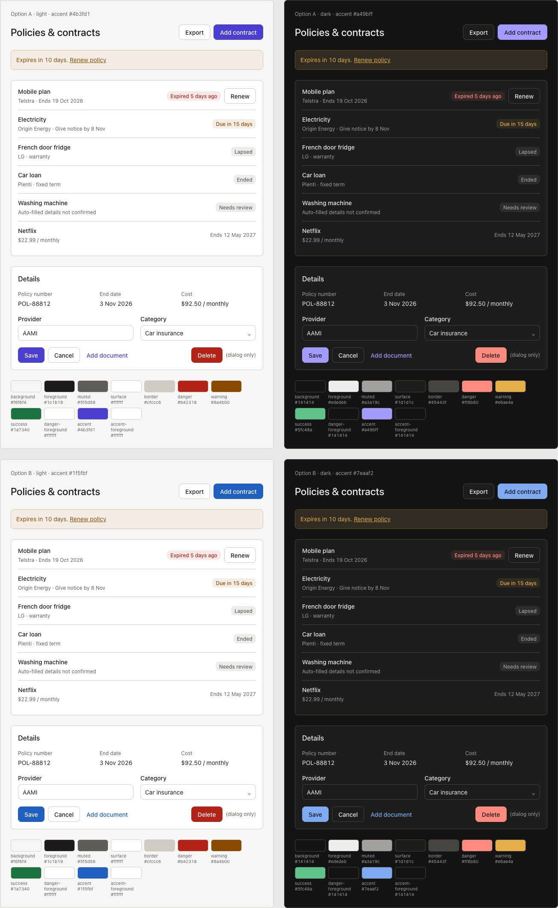
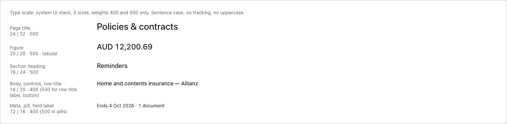
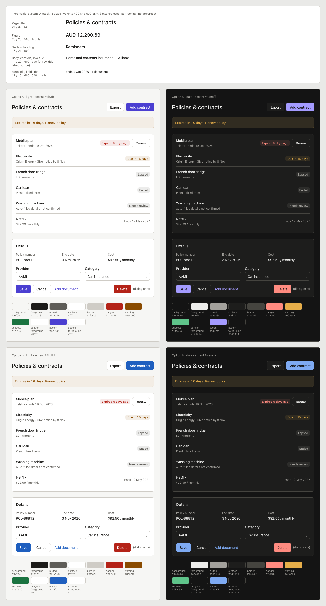

# Palette and type options (design audit, 24 Oct 2026)

Decision on 24 Oct 2026: **Option B (plain blue)**. On 25 Oct three light values were darkened slightly so a tinted button on a tinted banner still reaches 4.5:1 (see "Final light values" below). Option A is kept here for later review. Applied through #408; the shared UI rules are in their own issue.

The current tokens (`src/app/globals.css`) copy Stripe's design system: accent `#533afd`, navy `#061b31`, `--shadow-stripe`, and an indigo dark theme `#1c1e54`. Both options below replace them with neutral greys and one accent.

## Shared neutrals

| Token | Light | Dark |
|---|---|---|
| background | `#f6f6f4` | `#141414` |
| surface | `#ffffff` | `#1d1d1c` |
| foreground | `#1c1b19` (15.9 / 17.2) | `#ededeb` (15.7 / 14.4) |
| muted | `#5f5d58` (6.1 / 6.6) | `#a3a19c` (7.1 / 6.5) |
| border (non-text) | `#cfccc6` (1.48 / 1.60) | `#45443f` (1.9 / 1.7) |
| hover | foreground at 5% | foreground at 5% |

Contrast is shown as bg / surface. Also set `color-scheme: light dark`.

## Accent

| Option | Light accent | Contrast (bg / surface / white on fill / on tint) | Dark accent | Contrast (bg / surface / dark text on fill) |
|---|---|---|---|---|
| A: purple, tuned (no longer Stripe's exact hue) | `#4b3fd1` | 6.6 / 7.2 / 7.2 / 6.1 | `#a49bff` | 7.6 / 7.0 / 7.6 |
| **B: plain blue (chosen)** | `#1f5fbf` | 5.6 / 6.1 / 6.1 / 5.3 | `#7eaaf2` | 7.8 / 7.2 / 7.8 |

With B, `--info` is dropped because blue becomes the accent.

## Final light values (25 Oct 2026)

The stacked-tint contrast check in `scripts/check-contrast.mjs` (tone text on tone/10 over tone/10) found three light tokens just under 4.5:1. Each was darkened by the smallest same-hue step that passes. Dark-mode values are unchanged.

| Token | Approved | Final |
|---|---|---|
| accent | `#1f5fbf` | `#1e5bb6` |
| danger | `#b42318` | `#b02218` |
| success | `#1a7340` | `#186b3c` |

The specimen images still show the approved values; the difference isn't visible at that size.

## Semantic colours (one tone each; pill = 10% tint on surface)

| Colour | Light | Contrast (surface / pill) | Dark | Contrast (surface / pill) |
|---|---|---|---|---|
| danger | `#b42318` | 6.6 / 5.6 | `#ff8b80` | 7.4 / 6.3 |
| warning | `#8a4b00` | 6.8 / 5.9 | `#e6ae4a` | 8.5 / 7.0 |
| success | `#1a7340` | 5.9 / 5.1 | `#5fc48a` | 7.8 / 6.5 |

Dark mode gains a `--danger-foreground` / `--accent-foreground` of `#141414`. Today's white-on-danger in dark mode is 3.23:1.

## State colours (glossary)

| State | Colour |
|---|---|
| Overdue, Expired | danger |
| Due soon | warning |
| Lapsed, Ended, Cancelled, Archived, Needs review | neutral pill |
| Later (outside the due-soon window) | plain muted text, no pill |

Success is only used for confirmations and gains.

## Type scale

The system UI font stays. Use 5 sizes and 2 weights (400/500), sentence case only, and `tabular-nums` on body.

| Role | Size / line height | Weight |
|---|---|---|
| Page title | 24/32 | 500 |
| Key figure | 20/28 | 500 |
| Section heading, card title | 16/24 | 500 |
| Body, controls, labels | 14/20 | 400 (500 for row titles, labels, buttons) |
| Meta, pills, hints | 12/16 | 400 (500 in pills) |

The specimen's page heading ("Policies & contracts") is sample copy only. The glossary noun is Contracts (#362).
